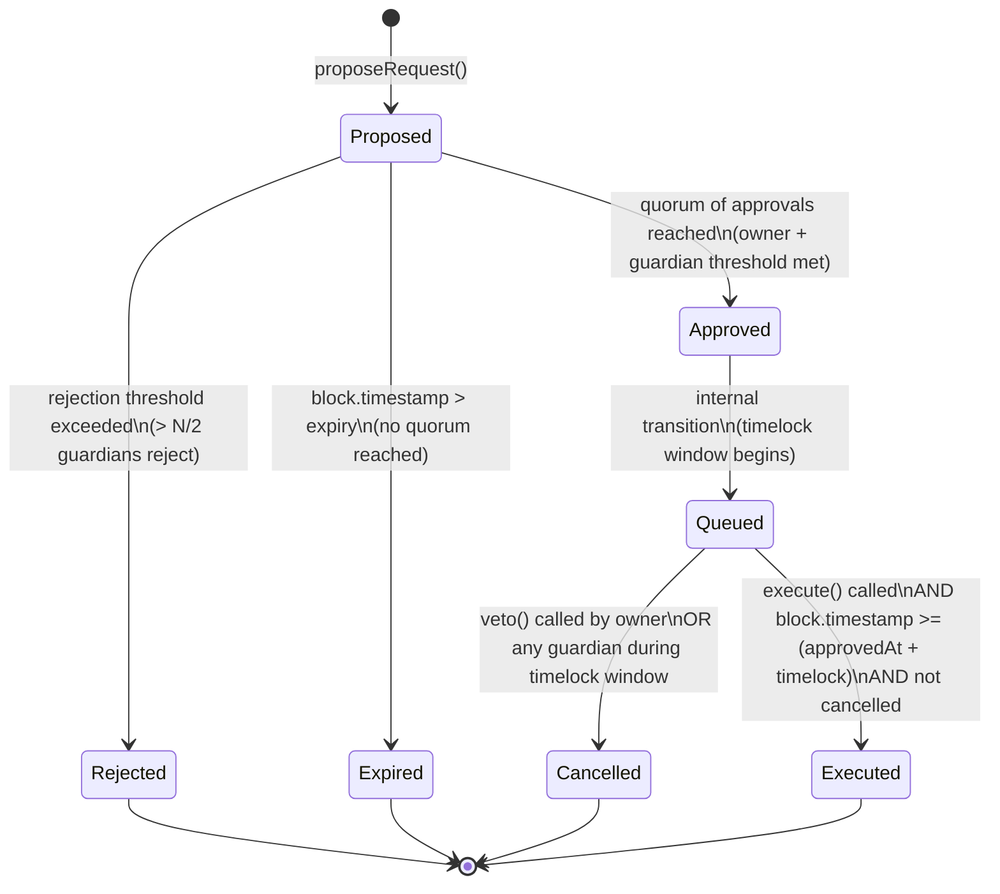

# ChainTrust – DomainGuard Architecture
**Stage 1 Design Lock | BlockHack PS-08 "The Rogue Admin"**

---

## 3.1 Core Principle

The `DomainGuard` smart contract is the **sole authority** over domain state. There is no admin setter, no owner override, and no backdoor of any kind. Domain state transitions happen **exclusively inside `execute()`**, and only after the policy for that operation type has been fully satisfied on-chain. The contract cannot be paused, upgraded, or short-circuited by any single participant—including the deployer. Once deployed, authority belongs to the policy rules, not to any individual or organisation.

---

## 3.2 Participants and Roles

### Registrar Admins (Proposers)
- Employees of the domain registrar with legitimate system access.
- May call `proposeRequest()` to initiate any operation.
- **Cannot approve or veto any request they themselves proposed** (enforced by the contract: `require(request.proposer != msg.sender)`).
- Represent the attack surface for "rogue admin" scenarios.

### Domain Owner
- The registrant—the organisation or individual who registered the domain.
- Must countersign (approve) operations that affect their own domain: `TRANSFER_OWNERSHIP` and `DNS_UPDATE`.
- Cannot propose operations (that role belongs to Admins).
- Their key can be lost and recovered via the `RECOVERY` operation type.

### Guardians
- Independent external organisations: e.g., Registry Operator, Auditor Firm, Legal Escrow Agent, Insurance Provider, Government TLD Authority.
- **Demo configuration:** N = 5 guardians, indexed 0–4.
- May approve, reject, or veto any request.
- Any single guardian may **instantly freeze** a domain (safe direction).
- Unfreeze and policy changes require a quorum of guardians.
- Guardians can be replaced via the `KEY_REPLACEMENT` operation (the old key is invalidated on execution).

### Attacker Model
| Threat | Description |
|--------|-------------|
| Rogue Admin | Legitimate admin proposes a transfer to their own address and attempts self-approval and early execution. |
| Lost Key | One guardian key is irrecoverably lost (hardware failure / employee departure). |
| Malicious Guardian | One guardian actively colludes with the rogue admin, providing a single corrupt approval. |

---

## 3.3 Domain State On-Chain

Each domain is identified by a `bytes32` hash of its fully-qualified domain name (e.g. `keccak256("example.com")`). The **actual domain name string is never stored on-chain** (privacy & gas).

```
struct DomainRecord {
    address owner;          // current owner EOA or multisig
    bytes32 dnsRecordHash;  // keccak256 of the current zone-file content
    bool    frozen;         // emergency freeze flag
    uint64  nonce;          // increments on every successful execute(); prevents replay
}
```

**Not stored on-chain:** zone-file contents, WHOIS personal data, billing information, registrar internal IDs.

---

## 3.4 Operation Types and Policy Table

All timelock values are constructor parameters, allowing demo-friendly small values on the local Hardhat chain while remaining configurable for realistic deployments.

| Operation Type | Who May Propose | Owner Approval Required | Guardian Threshold (of 5) | Timelock (demo default) | Notes |
|----------------|-----------------|------------------------|--------------------------|------------------------|-------|
| `TRANSFER_OWNERSHIP` | Registrar Admin | ✅ Yes | ≥ 3 | 120 s | Proposer cannot be the approver or the beneficiary |
| `DNS_UPDATE` | Registrar Admin | ✅ Yes | ≥ 2 | 60 s | Replaces `dnsRecordHash` on execution |
| `KEY_REPLACEMENT` | Registrar Admin | ❌ No | ≥ 3 (excl. lost key) | 120 s | Replaces a single guardian address; old address revoked immediately on execution |
| `RECOVERY` | Registrar Admin | ❌ No (owner key is lost) | ≥ 3 | 180 s | Sets new owner address; old owner key invalidated on execution; longest timelock gives maximum veto window |
| `EMERGENCY_FREEZE` | Any Guardian | ❌ No | 1 (instant) | None | Bypasses normal lifecycle; immediate state change; reverses via UNFREEZE |
| `UNFREEZE` | Registrar Admin | ❌ No | ≥ 3 | 60 s | Standard lifecycle applies after quorum |

### Threshold Constants (deployment-time configuration)

```
THRESHOLD_TRANSFER   = 3   // guardians
THRESHOLD_DNS        = 2   // guardians
THRESHOLD_KEYREP     = 3   // guardians (minus lost key)
THRESHOLD_RECOVERY   = 3   // guardians
THRESHOLD_UNFREEZE   = 3   // guardians

TIMELOCK_TRANSFER    = 120 // seconds
TIMELOCK_DNS         = 60  // seconds
TIMELOCK_KEYREP      = 120 // seconds
TIMELOCK_RECOVERY    = 180 // seconds
TIMELOCK_UNFREEZE    = 60  // seconds
```

---

## 3.5 Request Lifecycle

Every sensitive operation follows the same lifecycle. `EMERGENCY_FREEZE` is the sole exception—it bypasses the lifecycle entirely and takes immediate effect.

### State Diagram



### Lifecycle Step Details

| Step | Who | Action | Contract call |
|------|-----|--------|--------------|
| 1 | Registrar Admin | Submits the intended operation with all parameters | `proposeRequest(domainId, opType, params)` |
| 2 | Domain Owner | Countersigns if the operation type requires it | `approveRequest(requestId)` |
| 3 | Guardians (multiple) | Each independently approves or rejects on-chain | `approveRequest(requestId)` / `rejectRequest(requestId)` |
| 4 | — | Contract checks if quorum is met after each approval | Automatic inside `approveRequest()` |
| 5 | — | Once quorum met, request moves to Queued; timelock clock starts | Automatic state transition |
| 6 | Owner or any Guardian | May veto during the timelock window to cancel | `vetoRequest(requestId)` |
| 7 | Anyone | After timelock elapses and no veto, calls execute | `execute(requestId)` |
| 8 | Contract | Validates state, applies domain state change, emits event, increments nonce | Internal only |

---

## 3.6 Safety Rules

These are contract-enforced invariants, not off-chain policy:

1. **No self-approval:** `require(requests[id].proposer != msg.sender)` in `approveRequest()`.
2. **One vote per participant per request:** A mapping `hasVoted[requestId][address]` is checked; duplicate calls revert.
3. **No double-execution:** `require(requests[id].status == Status.Queued)` in `execute()`; status is set to `Executed` atomically.
4. **Request expiry:** Every request carries an `expiresAt` timestamp. If `block.timestamp > expiresAt` and quorum has not been reached, the request can be marked `Expired` (anyone may call `expireRequest(requestId)`).
5. **Vote binding:** Approval is recorded against the exact `requestId`. Approvals cannot be transferred to a different request.
6. **Revoked-key invalidation:** When a `KEY_REPLACEMENT` or `RECOVERY` executes, the old address is removed from the guardian/owner set. Any subsequent calls from that address revert (`require(isGuardian[msg.sender])` etc.).
7. **Input validation:** All `proposeRequest()` parameters are validated: non-zero addresses where required, non-zero hashes, valid `domainId`, valid `opType`.
8. **Frozen domain protection:** Any operation other than `EMERGENCY_FREEZE`, `UNFREEZE`, and `RECOVERY` reverts if `domain.frozen == true`.
9. **Nonce binding:** The request captures the domain's `nonce` at proposal time. If the domain's nonce has advanced before `execute()` runs, the execution reverts.

---

## 3.7 Events

All significant state changes emit events, providing a fully auditable on-chain log.

```
event DomainRegistered(bytes32 indexed domainId, address indexed owner);

event RequestProposed(
    uint256 indexed requestId,
    bytes32 indexed domainId,
    uint8   opType,
    address indexed proposer,
    uint256 expiresAt
);

event RequestApproved(uint256 indexed requestId, address indexed approver);

event RequestRejected(uint256 indexed requestId, address indexed rejecter);

event RequestQueued(
    uint256 indexed requestId,
    uint256 timelockEndsAt
);

event RequestVetoed(uint256 indexed requestId, address indexed vetoer);

event RequestExecuted(uint256 indexed requestId, bytes32 indexed domainId, uint8 opType);

event RequestExpired(uint256 indexed requestId);

event DomainFrozen(bytes32 indexed domainId, address indexed frozenBy);

event DomainUnfrozen(bytes32 indexed domainId);

event GuardianReplaced(address indexed oldGuardian, address indexed newGuardian);

event OwnerRecovered(bytes32 indexed domainId, address indexed oldOwner, address indexed newOwner);
```

---

## 3.8 Demo Scenarios

Each scenario maps directly to on-chain transactions on the local Hardhat chain (chain ID 31337).

### Scenario A — Rogue Admin Attack (Hour-4 Event)

| Step | Transaction | Expected Outcome |
|------|-------------|-----------------|
| 1 | `admin.proposeRequest(domainId, TRANSFER_OWNERSHIP, rogueAddress)` | ✅ Succeeds — proposal recorded |
| 2 | `admin.approveRequest(requestId)` | ❌ **REVERTS** — proposer cannot approve own request |
| 3 | `colluding_guardian.approveRequest(requestId)` | ✅ Succeeds — 1 of 3 required guardian approvals |
| 4 | `admin.execute(requestId)` (before quorum) | ❌ **REVERTS** — quorum not met |
| 5 | 1 more guardian approves — still only 2 of 3 needed | ✅ Succeeds — 2 approvals, quorum still not met |
| 6 | `admin.execute(requestId)` (still before quorum) | ❌ **REVERTS** — quorum not met |
| — | **Attack fails silently without any central administrator intervening** | — |

### Scenario B — Legitimate Transfer

| Step | Transaction | Expected Outcome |
|------|-------------|-----------------|
| 1 | `admin2.proposeRequest(domainId, TRANSFER_OWNERSHIP, newOwner)` | ✅ Proposal recorded |
| 2 | `owner.approveRequest(requestId)` | ✅ Owner countersignature recorded |
| 3 | Guardians 0, 1, 2 each call `approveRequest(requestId)` | ✅ Quorum (3 of 5) reached → status → Queued |
| 4 | `evm_increaseTime(120)` + `evm_mine` *(local-dev-chain time control)* | Chain time advances past timelock |
| 5 | `anyone.execute(requestId)` | ✅ Executes; `domain.owner` updated; `DomainTransferred` event emitted |

### Scenario C — Lost Guardian Key Recovery

| Step | Transaction | Expected Outcome |
|------|-------------|-----------------|
| 1 | `admin.proposeRequest(domainId, KEY_REPLACEMENT, {oldGuardian, newGuardian})` | ✅ Proposal recorded |
| 2 | Guardians 0, 1, 2 (excluding lost key at index 3) approve | ✅ Quorum (3 of 4 active) reached → Queued |
| 3 | `evm_increaseTime(120)` + `evm_mine` | Time advances |
| 4 | `anyone.execute(requestId)` | ✅ Executes; `isGuardian[oldGuardian]` = false; `isGuardian[newGuardian]` = true; `GuardianReplaced` emitted |
| 5 | `oldGuardian.approveRequest(anyFutureRequest)` | ❌ **REVERTS** — old key no longer a guardian |

### Scenario D — Emergency Freeze and Quorum Unfreeze

| Step | Transaction | Expected Outcome |
|------|-------------|-----------------|
| 1 | `guardian0.emergencyFreeze(domainId)` | ✅ Instant freeze; `DomainFrozen` emitted; no timelock |
| 2 | `admin.proposeRequest(domainId, TRANSFER_OWNERSHIP, ...)` | ❌ **REVERTS** — domain is frozen |
| 3 | `admin.proposeRequest(domainId, UNFREEZE, ...)` | ✅ UNFREEZE proposal allowed on frozen domain |
| 4 | Guardians 0, 1, 2 approve UNFREEZE | ✅ Quorum met → Queued |
| 5 | `evm_increaseTime(60)` + `evm_mine` | Time advances |
| 6 | `anyone.execute(unfreezeRequestId)` | ✅ `domain.frozen` = false; `DomainUnfrozen` emitted |

> **Note on time control:** `evm_increaseTime` and `evm_mine` are standard Hardhat JSON-RPC methods available on any development node. They manipulate the in-memory blockchain clock. This is a **local-dev-chain feature** used to simulate timelock elapse without waiting real time. All actual transaction logic, state changes, reverts, and event emissions are fully real on-chain operations.

---

## 3.9 REAL vs MOCK Table

| Item | Classification | Reason |
|------|---------------|--------|
| Contract deployment | **REAL** | Transaction on local Hardhat chain; real tx hash, block number |
| `proposeRequest()` calls | **REAL** | On-chain transactions; state written to contract storage |
| `approveRequest()` calls | **REAL** | On-chain transactions; approval bitmaps/counters updated in storage |
| `rejectRequest()` calls | **REAL** | On-chain transactions |
| `vetoRequest()` calls | **REAL** | On-chain transactions |
| `execute()` calls | **REAL** | On-chain state transition; reverts are real EVM reverts |
| `emergencyFreeze()` calls | **REAL** | On-chain state change |
| Revert conditions | **REAL** | EVM-enforced; cannot be bypassed |
| Emitted events | **REAL** | Written to chain logs; retrievable by tx receipt |
| Transaction hashes & block numbers | **REAL** | Generated by the Hardhat EVM |
| 20 funded accounts | **REAL** | Hardhat default test accounts; deterministic key pairs |
| `evm_increaseTime` / `evm_mine` | **LOCAL-DEV-CHAIN TIME CONTROL** | Manipulates in-process EVM clock; not available on public networks; used only to advance past timelocks during demos |
| Domain names in demos (e.g., "example.com") | **DEMO DATA** | Sample strings used to generate `bytes32` hashes; not real registrar records |
| DNS record content in demos | **DEMO DATA** | Placeholder zone-file strings; their `keccak256` hash is stored on-chain, content is off-chain |
| Guardian identities in demos | **DEMO DATA** | Hardhat test accounts standing in for real organisations |
| "Real DNS" propagation | **NOT IMPLEMENTED** | Non-goal; see §3.10 |

---

## 3.10 Non-Goals (Out of Scope for Hackathon MVP)

The following are **explicitly out of scope** and will not be implemented:

- Real DNS integration (no BIND, PowerDNS, or RDAP calls)
- Testnet deployment (Sepolia, Goerli, etc.) — local Hardhat only
- IPFS / Arweave for zone-file storage
- Backend server, REST API, or database
- Wallet-connect / WalletConnect / MetaMask deep-link flows
- Gas optimisation (no assembly, no bitpacking beyond natural struct layout)
- ERC-20/721 token integration
- Multi-chain / cross-chain features
- Real guardian identity verification (PKI, DIDs)
- Production key management (HSMs, MPC wallets)

---

## Implementation Notes (Stage 2)

### Deviations from Stage 1 Design

| Item | Stage 1 Design | Stage 2 Implementation | Reason |
|------|---------------|----------------------|--------|
| `propose()` caller | Admin only | Admin **or** Guardian | Spec §2 of stage prompt explicitly adds guardians as proposers; useful for emergency UNFREEZE proposals by a guardian without needing an admin. |
| `Status` enum | Proposed/Approved/Queued/Executed/Rejected/Cancelled/Expired | Pending/Approved/Executed/Rejected/Vetoed/Expired | "Queued" state is a sub-state of Approved (tracked by `eta`); combining them reduces complexity. "Cancelled" renamed Vetoed for clarity. |
| `EMERGENCY_FREEZE` Op type | Separate Op in the enum | `freezeDomain()` standalone function; NOT in Op enum | The freeze bypasses the request lifecycle entirely (instant, no quorum). Including it in the Op enum would create special-case logic throughout. The function is guardian-only and instant. |
| `_wasOldKey()` helper | N/A | Removed in Stage 3 | Originally proposed as a stub returning false; removed as dead code in Stage 3 cleanup since `isGuardian[oldKey]` is the exact authority check needed during vote counting. |
| `domainNonce` for KEY_REPLACEMENT | Not specified | Fixed at 0 (global op) | KEY_REPLACEMENT has no domain-specific nonce to bind to. Staleness is irrelevant for global guardian set operations. |
| Eligible-guardian calculation | "5 minus proposer (if guardian) minus oldKey" | Implemented in `_eligibleGuardians()` | Correctly reduces the guardian count for rejection threshold math. |
| Self-rejection | Not specified | Mirrors self-approval ban | Prevents a proposer from immediately rejecting their own proposal (consistency). |

---

## 4. Stage 3 Deployment Layout & Demo Architecture

### 4.1 Deployment Topology

The local environment operates on an in-memory/persistent Hardhat node listening on `http://127.0.0.1:8545` with fixed Chain ID `31337`.

```
                  ┌───────────────────────────────────────────────┐
                  │          Hardhat Node (Chain ID 31337)        │
                  │             http://127.0.0.1:8545             │
                  └───────────────────────┬───────────────────────┘
                                          │
            ┌─────────────────────────────┼─────────────────────────────┐
            ▼                             ▼                             ▼
   deployments/localhost.json    scripts/deploy.ts              DomainGuard.sol
   ├── address                   ├── deploys DomainGuard        ├── 1 Admin (Alex)
   ├── deployer                  ├── registers 3 demo domains   ├── 5 Guardians (Priya, Rahul,
   ├── delays                    └── exports ABI/artifacts      │   Maya, Marcus, Elena)
   ├── namedAccounts                                            ├── Delays: 60s/120s/120s/180s
   └── demo domains                                             └── 3 Demo Domains registered
            │
            ▼
   frontend/src/contracts/
   ├── DomainGuard.json (ABI)
   └── localhost.json (Deployment export)
```

### 4.2 Named Hardhat Signers & Roles

| Name | Role | Hardhat Signer | Address |
|------|------|----------------|---------|
| **Alex** | Admin & Deployer | Account #0 | `0xf39Fd6e51aad88F6F4ce6aB8827279cffFb92266` |
| **Priya** | Guardian 1 | Account #1 | `0x70997970C51812dc3A010C7d01b50e0d17dc79C8` |
| **Rahul** | Guardian 2 (lost key in demo C) | Account #2 | `0x3C44CdDdB6a900fa2b585dd299e03d12FA4293BC` |
| **Maya** | Guardian 3 | Account #3 | `0x90F79bf6EB2c4f870365E785982E1f101E93b906` |
| **Marcus** | Guardian 4 | Account #4 | `0x15d34AAf54267DB7D7c367839AAf71A00a2C6A65` |
| **Elena** | Guardian 5 | Account #5 | `0x9965507D1a55bcC2695C58ba16FB37d819B0A4dc` |
| **Sarah** | Domain Owner (Registrant) | Account #6 | `0x976EA74026E726554dB657fA54763abd0C3a0aa9` |
| **Victor** | Replacement Guardian Key | Account #7 | `0x14dC79964da2C08b23698B3D3cc7Ca32193d9955` |
| **Alice** | Legitimate New Domain Owner | Account #8 | `0x23618e81E3f5cdF7f54C3d65f7FBc0aBf5B21E8f` |

### 4.3 Demo Domain Records

Three demo domains are seeded upon deployment via `registerDomain()`:
1. `mybank.example`: `keccak256("mybank.example")`
   - Owner: Sarah (`0x976EA74026E726554dB657fA54763abd0C3a0aa9`)
   - DNS Record Hash: `keccak256("v=spf1 include:mybank.example ~all")`
2. `harborline.example`: `keccak256("harborline.example")`
   - Owner: Sarah (`0x976EA74026E726554dB657fA54763abd0C3a0aa9`)
   - DNS Record Hash: `keccak256("v=spf1 include:harborline.example ~all")`
3. `ledgerworks.example`: `keccak256("ledgerworks.example")`
   - Owner: Sarah (`0x976EA74026E726554dB657fA54763abd0C3a0aa9`)
   - DNS Record Hash: `keccak256("v=spf1 include:ledgerworks.example ~all")`

### 4.4 Demo Script Workflows

1. **`demo:attack` (`scripts/demo-attack.ts`)**
   - Hour-4 scenario: Alex (admin) proposes `TRANSFER_OWNERSHIP` of `mybank.example` to Alex.
   - Alex attempts self-approval: reverted with `SelfApprovalForbidden()`.
   - Alex attempts immediate execution: reverted with `QuorumNotReached()`.
   - 1 guardian (Elena) colludes and approves: execute still reverts with `QuorumNotReached()`.
   - On-chain inspection: `mybank.example` owner is unchanged.

2. **`demo:collusion` (`scripts/demo-collusion.ts`)**
   - Owner + 3 guardians approve a malicious transfer on `harborline.example`. Quorum reached, timelock queued.
   - Guardian Rahul detects the rogue transfer and invokes `veto()`.
   - Time is advanced past `transferDelay` via `evm_increaseTime` / `evm_mine`.
   - Attacker attempts execution: reverted with `QuorumNotReached()` (status is `Vetoed`).
   - A subsequent legitimate transfer to Alice is proposed, approved by Owner + 3 guardians, time-advanced, and successfully executed on-chain.

3. **`demo:keyloss` (`scripts/demo-keyloss.ts`)**
   - Guardian Rahul's key is lost.
   - Priya proposes `KEY_REPLACEMENT` of Rahul with Victor.
   - Rahul tries to vote on own replacement: reverted with `NotAuthorized()`.
   - 3 active guardians (Maya, Marcus, Elena) approve; quorum reached.
   - Time is advanced past `keyDelay` via `evm_increaseTime` / `evm_mine`.
   - Key replacement is executed: `GuardianReplaced` emitted.
   - Old key (Rahul) attempts to approve a new DNS request on `ledgerworks.example`: reverted with `NotAuthorized()`.
   - New key (Victor) approves: success. On-chain guardian list updated.

